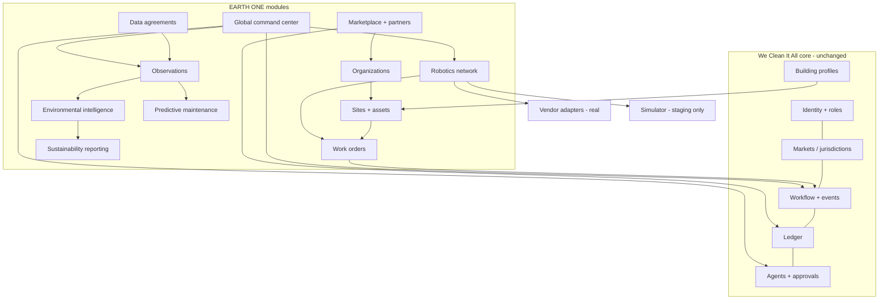

# Project EARTH ONE — Architecture
_Version 1 · 2026-11-02 · Design only._

## Reuse first
EARTH ONE is a set of **new modules in the same modular monolith**: the same Supabase Postgres, row-level security, checked database functions, edge-function doors, agents, outbox/inbox and PWA. These existing pieces are reused unchanged:

| Existing piece | EARTH ONE use |
|---|---|
| Identity, 2-step, roles (`user_roles` with scope) | new roles: municipal officer, enterprise facility manager, partner admin, data steward, command-center operator, robot supervisor |
| Markets (country → state → city → market, status, launch checklist) | becomes the **jurisdiction** model for every country |
| Bookings + workflow states + domain events | public/enterprise **work orders** use the same workflow engine |
| Building profiles (Digital Twin) | extended to **sites** (public spaces, campuses, facilities) |
| Mission Control + robotics adapter | the Robotics Network |
| Intelligence Network + Impact Engine | Environmental Intelligence, Waste, Resources, Reporting |
| Ledger + Stripe Connect | contracts, partner payouts, marketplace commissions |
| Agents (cap, kill switch, approvals, action log) | all EARTH ONE AI agents |

## New concepts (all PLANNED, additive)
| Concept | Tables | Purpose |
|---|---|---|
| Organizations | `organizations` (type: municipality, district, enterprise, supplier, robotics_company, ngo), `organization_members` | multi-party accounts |
| Sites & assets | `sites` (owner org, jurisdiction, boundary, type), `site_zones`, `assets` (bins, HVAC units, restrooms, robots' docks…) | what we serve and maintain |
| Work orders | `work_orders` (site, scope, SLA, recurring rule) → generates bookings/assignments | public and enterprise work |
| Data agreements | `data_agreements` (parties, data types, purpose, retention, expiry, status), `data_sources` (agreement, kind, connector), `data_access_log` | **no data flows without an active agreement** |
| Observations | `observations` (source, site/asset, metric, value, unit, time, `basis` MEASURED/ESTIMATED/PREDICTED/SIMULATED, method, agreement) | single store for environmental and sensor data |
| Predictions | `predictions` (asset, risk, confidence, evidence, reviewer, outcome) | predictive maintenance with measured accuracy |
| Jurisdiction rules | `jurisdiction_rules` (country/state/city, area: data, tax, labor, robotics, procurement, reporting; value; reviewed_by; reviewed_at) | multi-country compliance |
| Partner integrations | `partner_apps`, `api_keys` (hashed, scoped), `webhook_subscriptions`, `webhook_deliveries` | secure partner access |
| Command center | views + `alerts` (reuses agent tasks/approvals) | global operations view |

## Map

## Multi-country support
- **Jurisdiction settings:** each level (country, state, city) has currency, languages, time zone, tax rules, labor classification rules, data-protection regime, robotics rules (e.g., public-space operation limits) and procurement rules. A setting counts only once a person has reviewed it (`reviewed_by`).
- **Data residency:** where the law requires it (e.g., EU personal data), that region gets its **own regional Supabase project** with the same schema and code. Only anonymized aggregates cross regions. No regional project is created until a real customer there needs it.
- **Currency and payments:** Stripe in supported countries; ledger entries carry currency; reports convert only for display, with the rate and date shown.
- **Languages:** the app's existing i18n (English/Spanish/Creole) extends per country.

## Secure partner integrations
1. Partner registers → owner approves → partner gets **scoped API keys** (hashed at rest, per environment, rotatable, expiring).
2. Partner calls the same checked database functions through an API gateway edge function, with rate limits per key.
3. Outbound events go through **signed webhooks** (HMAC, retry via outbox, delivery log).
4. Inbound partner/vendor events are **signature-verified** and duplicates are ignored (inbox).
5. Any data a partner sends or receives must be covered by an active data agreement; every access is logged.
6. Sandbox environment first (staging), production keys only after a contract and tests.

## Global Operations Command Center (system 10)
One screen family in the owner/operator app (not a separate product):
- **Map and list** of markets → sites → active work orders, crews and robot missions (real and simulated in **separate, labeled views**).
- **Alerts:** stuck workflows, SLA risk, robot faults, data-feed failures, expiring agreements/insurance/certificates.
- **Approvals queue:** everything that needs a person (bids, prices, data sharing, robot deployments, public reports).
- **Health:** outbox/dead letters, AI spend, integration status.
- Access by role and scope: a city operator sees only their jurisdiction; the owner sees everything (2-step).

## Approval matrix (sensitive actions)
| Action | Who approves | Logged |
|---|---|---|
| Sign/submit a contract or public bid | owner (super admin) | audit_log |
| Change prices or SLA terms | owner or market ops manager (scoped) | audit_log |
| Activate a data agreement / share data outside the company | owner + data steward | data_access_log |
| Publish a sustainability claim or report | owner | audit_log + report version |
| Deploy a real robot to a site | ops manager + named supervisor, after field test | robot_missions |
| Activate a jurisdiction | owner, after launch checklist + legal review | market checklist |
| Penalize a provider / refund | owner | audit_log |
| Spend above a set limit (purchases, paid services) | owner | audit_log |

## Security and privacy
- Same base rules: RLS on every table, checked functions, secrets only in Supabase secrets/Vault, append-only logs.
- **Least data:** observations store metrics, not people. No face recognition. Camera feeds are not ingested; only derived counts are accepted, if a partner provides them under an agreement.
- **Location data:** sites and assets are public or business locations. Personal home addresses stay in the core booking module with its existing protections.
- **Retention:** each data agreement sets retention; a purge job enforces it.
- **Robots:** mission-level commands only, verified units only, safety systems never overridden (EARTH_ONE_ROBOTICS_NETWORK.md).
- Annual security review per stage; penetration test before the first municipal contract.

## What is deliberately not added
No IoT platform, data lake, streaming cluster, digital-twin 3D engine or separate microservices until a signed pilot needs them and pays for them (EARTH_ONE_BUSINESS_MODEL.md).
