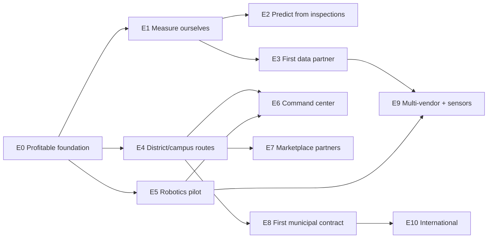

# Project EARTH ONE — Roadmap
_Version 1 · 2026-11-02 · Design only. EARTH ONE is Wave 9 of the master plan. Every stage: staging → tests → owner approval → live. No production change and no purchase without approval._

## Stages
| Stage | Goal | Systems | Prerequisite (must be true) | Exit proof | Rough added cost |
|---|---|---|---|---|---|
| **E0 Foundation** | profitable Miami-Dade + Broward marketplace, proven technology | — | MASTER roadmap phases 0–5 + Innovation Lab Waves 1–5 | positive per-job margin for 2 months; commercial contracts billing | (core plan) |
| **E1 Measure ourselves** | honest data from our own work | 6, 9 (own data), 5 (bag counts) | provider tools, impact engine | per-account reports with MEASURED/ESTIMATED labels approved and used by clients | ≈ $0 |
| **E2 Predict from inspections** | predictive maintenance without sensors | 4 | quality inspections on commercial sites | MEASURED prediction precision reaches the agreed bar | ≈ $0 + AI cents |
| **E3 First data partner** | one client shares meter/hauler data under agreement | 2, 5, 6, 9 | data agreements module, legal template | a measured baseline and a measured result at one site | ≈ $0–low |
| **E4 District / campus routes** | first multi-site recurring contract outside home cleaning | 1, 8 | organizations, sites, work orders, SLA reports | contract renewed | insurance/bonding per contract |
| **E5 Robotics pilot** | first real robot missions under supervision | 3 | vendor agreement, field test, insurance, supervisor training | safe missions; metrics now MEASURED | paid by pilot client/partner |
| **E6 Command center** | one global view of operations | 10 | E4 + E5 running | operators use it daily | ≈ $0 (existing app) |
| **E7 Marketplace partners** | suppliers and robotics companies onboard | 7 | partner API, seller verification | partners transacting | low |
| **E8 First municipal contract** | public-sector work | 1, 8 | legal review, bid readiness, penetration test | contract delivered to SLA | bid + compliance costs |
| **E9 Second vendor / sensors** | multi-vendor robots, live sensor feeds | 3, 2, 4 | signed paying pilots | each pilot covers its cost | paid by pilot |
| **E10 International** | first country outside the US | all | jurisdiction review by local counsel, regional project if required | jurisdiction checklist complete | regional project + legal |

## Dependency view

## Gates for every stage
1. The cleaning business is unaffected (core tests pass; feature flags off by default).
2. No open CRITICAL/HIGH finding.
3. Costs shown and approved before anything is bought.
4. KPIs defined before shipping and measured after.
5. Legal/jurisdiction review done where the stage touches new contracts, data or territory.
