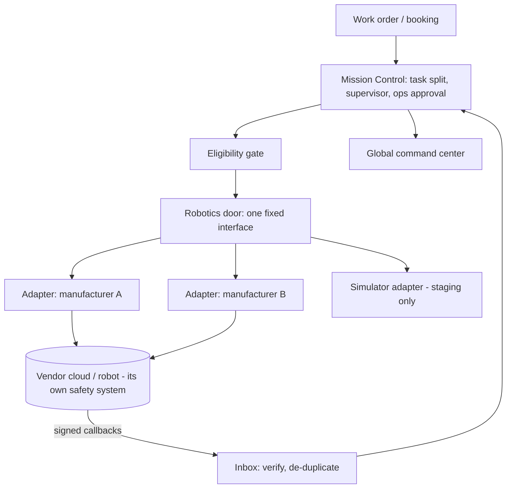

# Project EARTH ONE — Autonomous Robotics Network (system 3)
_Version 1 · 2026-11-02 · Design only. **No robot hardware is available or connected. No manufacturer agreement exists.** Extends MASTER_ROBOTICS_ARCHITECTURE.md._

## Purpose
Coordinate robots from **several manufacturers** through one safe, vendor-neutral platform for suitable cleaning and maintenance tasks, always with human supervision, so customers and partners get robot capacity without being tied to one brand.

## Real vs simulated — kept apart by design
| | Real | Simulated |
|---|---|---|
| Where | production, active markets only | staging and tests only |
| Flag | `is_simulated = false`, `integration_verified`, `field_test_passed` | `is_simulated = true` (cannot be changed later) |
| Adapter | manufacturer adapter | `simulator` adapter |
| Data | `robot_*` tables, real metrics | same tables, **excluded from every real metric and report** by a database rule |
| Screens | normal views | separate view with a **SIMULATION** banner |
| Booking link | allowed after checks | **blocked** by trigger from any real customer booking |

## Layers

## Fixed interface (every manufacturer)
`describe` (capabilities) · `status` (ready/charging/fault, battery, location if provided) · `request_mission` (zone, task, time window; idempotency key; via outbox) · `progress` · `pause` / `cancel` (only where the vendor supports them). **No low-level motion or safety commands exist in the interface.**

## Eligibility gate (all must be true)
Provider approved and insured for robotics · unit `integration_verified` and `field_test_passed` (evidence recorded by an admin) · jurisdiction allows that robot class in that kind of space (indoor / outdoor / public) · site zone marked robot-OK · task allowed by `robot_task_rules` · unit ready, battery and maintenance OK · **named human supervisor assigned and on duty**.

## Safety rules
1. Manufacturer safety systems, emergency stop, obstacle detection and geofencing stay in the vendor stack. **AI and the platform can never override, disable or bypass them.**
2. Every mission has a named supervisor with a stop/escalate path (pause/cancel via vendor API, plus physical access).
3. Public-space robots follow local rules, and only robot classes the vendor certifies for that use are allowed.
4. Faults, unexpected stops or geofence breaches → mission `needs_attention` → supervisor and ops alerted → human fallback crew via rescue dispatch → incident record.
5. Robots on public property only with the site owner's written permission and the right insurance.

## Robot supervision certification
Supervisors complete the Academy robot-supervision course plus the manufacturer's own training before their first mission.

## Data
`robot_manufacturers`, `robot_models`, `robot_fleets` (owned by a robotics-company organization or provider), `robot_units`, `robot_task_rules`, `robot_missions`, `robot_telemetry` (sampled, partitioned, retention set), `robot_maintenance`, `robot_integrations` (credentials in Vault), `robot_incidents`.

## Metrics
Mission success rate, supervisor interventions per mission, area cleaned per hour, utilization, incidents per 1,000 hours. **All show "not measured" until real missions exist.** Simulated numbers are never shown in the same chart.

## Costs and risks
| Item | Estimate |
|---|---|
| Software (adapter + simulator) | development time only; runs on existing infrastructure |
| Robots, leases, docks | **not estimated**: vendor quotes needed; paid by a signed pilot customer or robotics partner |
| Insurance (robot liability) | quote required |
| Vendor API fees | per manufacturer, unknown until talks |

| Risk | Mitigation |
|---|---|
| Vendor has no usable API | choose vendors with documented fleet APIs; pilot first |
| Safety incident | supervision, vendor safety stack, insurance, incident process |
| Lock-in to one vendor | fixed interface; second vendor only after first pilot proves value |
| Hype outruns reality | robot features advertised only in markets with verified units |

## Stages
R0 simulator on staging (labeled) → R1 first vendor talks + test unit in a controlled site → R2 field test + one paying commercial pilot → R3 second vendor through the same interface → R4 outdoor/public use only where law, permission and insurance allow.
