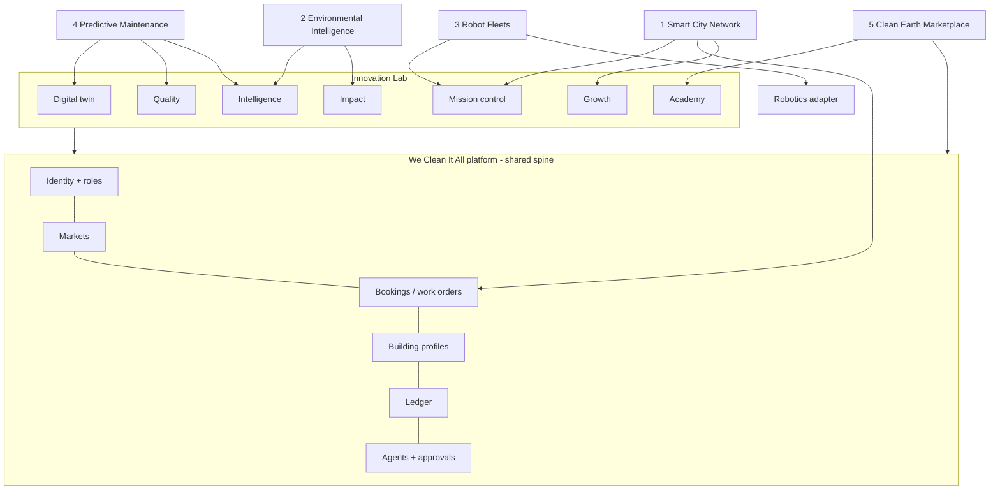

# Project EARTH ONE — long-term vision
_A global environmental operations network built on the We Clean It All platform. Version 1 · 2026-11-02 · Vision and design only. Wave 9 of the roadmap: nothing here starts before the home markets are profitable and the Innovation Lab waves are proven._

**Vision:** grow from cleaning buildings to helping keep cities cleaner, buildings healthier and environments more sustainable, through one network of customers, businesses, municipalities, providers, suppliers and robotics companies.
**Rule:** EARTH ONE is the same operating system, not a new company stack. Every frontier reuses identities, roles, markets, booking/work-order records, building profiles, the ledger, the agents and the robotics adapter.

## Honesty rules (same as the Innovation Lab, plus)
1. Only **authorized** data: sensors, cameras, meters and city data are used only under a written agreement with the data owner.
2. No claim of city partnerships, robot fleets or environmental results until they exist and are measured.
3. Public-space work follows each city's permits, procurement rules, labor and insurance requirements. Legal review comes before any bid.
4. AI predicts and recommends, with the PREDICTED label and an error range. People approve work orders, bids and spending.

## The five frontiers
| # | Frontier | What it is | Built on | Needs before it starts | Main risk |
|---|---|---|---|---|---|
| 1 | **Smart City Cleaning Network** | Coordinated cleaning and maintenance across commercial properties, authorized public spaces and facilities; recurring routes and service-level agreements | commercial contracts, work orders, Mission Control (multi-crew), markets | profitable commercial business; insurance and bonding levels for public work; first municipal or business-district (BID) customer | slow public procurement, permits |
| 2 | **Environmental Intelligence AI** | Analysis of authorized data (waste pickups, supply use, water/energy meters, complaints, inspection records) to find cleaning needs and waste patterns | Intelligence Network + Impact Engine | measured data from our own jobs first; data-sharing agreements | thin or poor-quality data; privacy |
| 3 | **Autonomous Robot Fleets** | Several manufacturers coordinated through the one vendor-neutral adapter, for suitable tasks (large floors, lobbies, parking areas) | robotics architecture + Mission Control | at least one successful single-vendor pilot; manufacturer agreements; insurance; safety review | hardware cost, vendor APIs, safety liability |
| 4 | **Predictive Building Maintenance** | Spotting likely problems (leaks, HVAC filters, wear, recurring dirt sources) from inspection records and authorized sensor data, before they get expensive | Digital Twin + Quality inspections + Intelligence | inspection history across many buildings; partner trades (plumbing, HVAC) or licensed staff; sensor data agreements | licensing for repair trades; liability for missed predictions |
| 5 | **Global Clean Earth Marketplace** | One marketplace connecting customers, businesses, municipalities, providers, equipment suppliers and robotics companies | marketplace core, partner API, supplier listings, Academy | strong two-sided marketplace in several markets; partner API live | spreading focus too thin |

## How it fits the existing architecture

**New concepts (planned, all additive):**
- **Sites:** public spaces and facilities with an owner organization and an authorization record. They are like properties but not tied to a single customer.
- **Organizations:** municipalities, business districts and suppliers, as new account types in roles.
- **Data agreements:** who authorized which data, its purpose, its retention, and when the agreement ends. No data flows without one.
- **Maintenance predictions:** asset, risk, PREDICTED label, evidence, reviewer, outcome. Outcomes are tracked so prediction accuracy is MEASURED.
- **Supplier catalog and equipment listings** in the marketplace.

## Staged path
| Stage | Step | Proof needed to move on |
|---|---|---|
| E0 | Innovation Lab Waves 1–5 done in Miami-Dade + Broward | profitable per job; commercial contracts billing |
| E1 | **Predictive maintenance light**: flag recurring issues from our own inspection records for commercial clients (no sensors) | clients act on the flags; MEASURED accuracy |
| E2 | **Environmental intelligence pilot** with one willing commercial client's authorized meter/waste data | a measured improvement against a baseline |
| E3 | **Business district / private campus** route contract (not yet a city): multi-site recurring cleaning | contract renewed |
| E4 | **Multi-vendor robotics**: a second manufacturer added through the same adapter after the first pilot succeeds | both vendors pass field tests |
| E5 | **First municipal contract**, via public bid, after legal review | contract delivered to SLA |
| E6 | **Clean Earth Marketplace**: suppliers, robotics companies and municipalities onboard as account types | each side transacting |
| E7 | Replicate city by city using the market launch checklist | checklist per market |

## Business model (directional)
Municipal and business-district service contracts · predictive-maintenance subscriptions for commercial buildings · environmental reporting subscriptions (measured data only) · marketplace commissions from suppliers and robotics companies · Robot-as-a-Service commissions. **No revenue figures are estimated yet**, because none of these markets have been tested.

## Cost stance
EARTH ONE adds no infrastructure until a stage needs it. Sensor/IoT platforms, large data systems and robot fleets are paid for **by a signed customer or partner pilot**, not in advance.

## What makes this credible
It grows out of real, measured work. Each stage is a small pilot with one customer, and only proven pilots scale. The mission becomes real through records, not slogans: **A cleaner Earth. A smarter future.**
