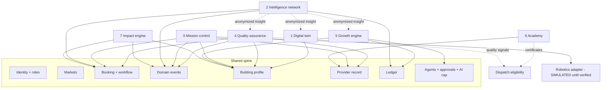

# We Clean It All — Innovation architecture
_Version 1 · 2026-11-02 · Design only._

## One platform, not seven apps
All seven systems are **modules inside the existing modular monolith**: the same Supabase database, the same row-level security, the same checked database functions, the same edge-function doors and the same PWA. They share one spine:

| Shared spine | Today | Used by |
|---|---|---|
| Identity (`profiles`, auth, 2-step) | LIVE | all |
| Roles and scopes (`user_roles`: owner, ops manager, provider, customer, commercial member, instructor, sales) | PLANNED (Phase 1) | all |
| Markets (`markets`, pricing, tax, coverage) | LIVE | all |
| Booking record (`bookings` + workflow state) | LIVE + BUILT | 1, 2, 3, 4, 7 |
| Domain events (append-only history) | BUILT | 2, 3, 4, 7 |
| Building profile (`properties`, `property_areas`) | PLANNED | 1, 3, 4, 5, 7 |
| Provider record (`workers`, compliance, coverage) | LIVE | 3, 4, 6 |
| Ledger (`ledger_entries`) | PLANNED (Stripe phase) | 2, 5, 6, BI |
| Agents (registry, settings, approvals, action log, AI cap) | LIVE | 1–7 |
| Outbox / inbox (retries, webhooks) | BUILT | 3, 5, 6 |
| Private storage (`worker-docs`, new `job-media`, `property-files`) | partly LIVE | 1, 4, 6 |

## Map

## How data flows between systems
1. A **building profile** (1) gives each booking its areas and tasks → the **checklist** (4) and the **crew split** (3).
2. Check-in/out, checklist results, photos and reviews become **domain events**.
3. Nightly, events become anonymized **job facts** (2) → better estimates for the twin (1), pricing, and proposals (5).
4. **Quality flags** (4) and **certificates** (6) feed **dispatch eligibility and ranking**: the existing `rank_workers` gets more inputs; no second dispatcher.
5. Travel and supply usage from jobs feed the **impact engine** (7), with every figure labeled MEASURED or ESTIMATED.
6. The **growth engine** (5) uses twins + intelligence + the ledger's real margins to draft proposals that a person approves.

## New database objects (all additive, RLS on, reached through checked functions)
| System | Tables |
|---|---|
| 1 | properties, property_areas, property_tasks, property_files, property_equipment_needs |
| 2 | intel_job_facts, intel_aggregates, intel_publish_log |
| 3 | assignments, assignment_events (+ robot_* from the robotics plan, `is_simulated` everywhere) |
| 4 | checklist_templates, job_checklists, job_photos, inspections, quality_flags, corrective_jobs |
| 5 | prospects, opportunities, proposals, sales_activities, contact_consents |
| 6 | courses, lessons, quizzes, quiz_attempts, enrollments, certificates |
| 7 | impact_measurements, supply_catalog, supply_usage, impact_baselines |

Rules: additive migrations with rollback files; staging first; no data deletion without owner approval; large tables (photos metadata, events, telemetry) partitioned by month only when they grow.

## AI layer
- One AI caller (`ai.ts`) with the monthly cap, per-agent kill switches and the append-only action log, as today. New agents register in `agent_registry`; nothing runs without a key, a passing evaluation set and owner switch-on.
- Proposed new agents: Property Profiler (1), Insight Writer (2), Mission Supervisor (3), Quality Reviewer (4), Sales Researcher + Proposal Writer (5), Academy Tutor (6), Impact Reporter (7).
- Every agent: reads through functions with the caller's permissions; writes **only drafts, flags or approval requests**; outputs carry a label (ESTIMATED / PREDICTED / AI draft).
- Images (quality photos): sent to the AI only when that feature is switched on, with no face analysis.

## APIs
All new operations are database functions (RPC) called by the PWA, with edge functions only where an outside service is involved:
- Existing doors reused: `notify` (messages), `whatsapp-in`, `brain`/`ai-ceo` (AI).
- New doors (when needed): `media` (signed upload URLs + checks), `payments` (Stripe, already planned), `robotics` (vendor adapters, SIMULATED first).
- Partner API (later) exposes the same functions with scoped keys. No separate backend per system.

## Security and privacy architecture
| Concern | Control |
|---|---|
| Who sees a building | owner account members; assigned provider only during the job window; access codes encrypted |
| Photos | private bucket, signed URLs, retention purge, no face analysis |
| Intelligence data | anonymized facts, minimum group size 10, external sharing logged + approved |
| Sales outreach | consent table, opt-out honored, owner approval per send |
| Certificates | graded in DB, public verify by code only (no personal details) |
| Impact claims | MEASURED/ESTIMATED label is a required column; public claims need approval |
| Robots | mission-level only, verified + field-tested units, supervisor required, no safety override |
| AI | caller-scoped tools, drafts only, cap + kill switch, append-only log |

## What we deliberately do NOT add now
No data warehouse, no ML training pipeline, no 3D/BIM engine, no IoT platform, no separate microservices, no paid lead databases, no video platform. Each can be added later **only** when the business case in INNOVATION_BUSINESS_MODEL.md is met.
