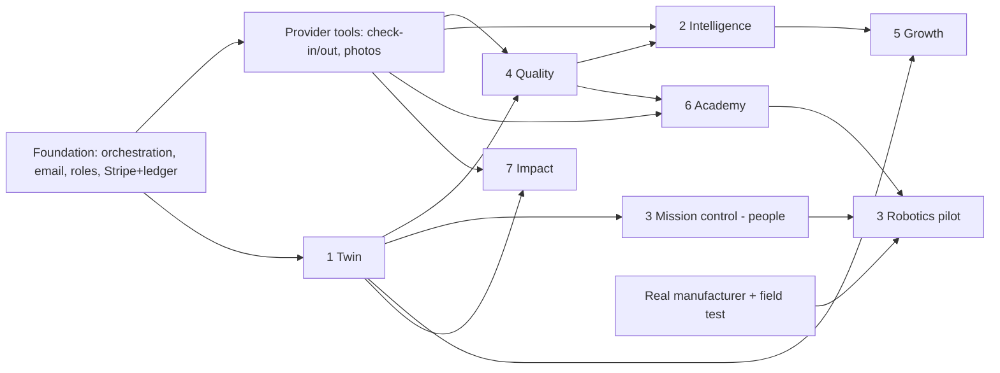

# We Clean It All — Innovation roadmap
_Version 1 · 2026-11-02 · Design only. Replaces the earlier INNOVATION_ROADMAP.md._

Every step: staging → tests → owner approval → live. No step starts until its dependencies are live. Steps marked ★ are part of the core customer journey and come first.

## Waves
| Wave | Goal | Innovation steps | Needs first (from MASTER_IMPLEMENTATION_ROADMAP) | Exit test |
|---|---|---|---|---|
| **0 Foundation** | core journey recorded and paid | — | Orchestration live, email fixed, roles, Stripe + ledger | real jobs complete with payment and full history |
| **1 Prove the work** ★ | every job verifiable | Quality P1–P2 (checklist, photos, missed-task, review queue, corrective jobs) · Twin P1 (room list) · Impact P1 (travel distance, eco-supply option) | provider tools (check-in/out) | missed-task rate and estimate accuracy are MEASURED for Miami-Dade + Broward |
| **2 Profitable home markets** ★ | accurate pricing, better crews | Twin P2–P3 (checklist from profile, labor estimate) · Academy P1 (3 required modules) · Intelligence P1 (nightly facts + owner report) · Mission Control P1 (multi-person jobs) | Wave 1 | margin per job positive and known from the ledger for 2 straight months |
| **3 Commercial growth** | recurring commercial revenue | Growth P1–P3 (tracker, AI proposal drafts, approved follow-ups) · Quality P3 (inspections) · Twin P4 (floor plans, multi-location) · Mission Control P2 (live board) · Academy P2 (certificates + specialty dispatch) | commercial module, Stripe Invoicing | first signed contracts billed through the platform |
| **4 Intelligence** | the platform learns | Intelligence P2–P3 (AI insights, demand forecast) · Quality P4 (AI flag pilot, measured vs human review) · Mission Control P3 (delay alerts) · Impact P2–P3 (supply usage, labeled reports) · Academy P3 (AI tutor) | a few hundred completed jobs of real data | AI flags beat a set precision bar; forecasts show their error |
| **5 New revenue** | additional income lines | Academy P4 (paid courses) · Quality P5 (Guaranteed Clean plan) · Growth P4–P5 (underserved markets, renewals) · Impact P4 (measured baselines) · Intelligence P4 | Waves 2–4 | each line covers its own cost |
| **6 Robotics** | first human + robot jobs | Mission Control P4 (registry + **labeled simulator** on staging) → P5 (one-building pilot with a real vendor, supervisor, field test) · Academy P5 (robot supervision course) | a manufacturer agreement, insurance, safety review | pilot passes field test; robot data never mixed with simulated data |
| **7 Ecosystem & expansion** | operating system for the industry | Intelligence P5 (external anonymized reports) · Twin P5 (authorized building data) · Impact P5 (meter/robot energy) · partner API · next markets | all above; market launch checklist | each new market passes its checklist |

## Dependency graph

## Gates (apply to every wave)
1. No CRITICAL/HIGH open finding from the architecture review.
2. All tests for the step pass on staging and are recorded in TEST_REPORT.md.
3. Cost of the step is shown and approved before paid services are switched on.
4. KPIs for the step are defined before it ships, so its value can be judged afterwards.
5. **Expansion beyond Miami-Dade + Broward waits until Wave 2's exit test passes.**
