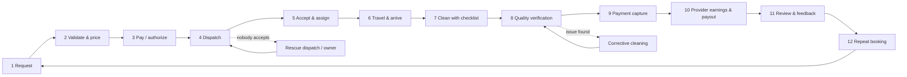

# We Clean It All — Master customer-to-completion journey
_The heartbeat of the company. Version 1 · 2026-11-02. Design only; nothing in this document has been newly deployed._

Status legend: **LIVE** (production, tested) · **BUILT** (tested, not applied) · **PLANNED**.
Guiding rule: **Miami-Dade and Broward must run profitably on this journey before any new market opens.**

## The journey at a glance

## Stage by stage
| # | Stage | Customer sees | Provider sees | System does (source of truth) | Workflow state | Status |
|---|---|---|---|---|---|---|
| 1 | **Request** | Picks service, home/business, ZIP, date, size; price suggestion shown | — | Guest or signed-in session; ZIP → market (`market_for_zip`) | REQUESTED | LIVE |
| 2 | **Validate & price** | Fair price with the minimum enforced, 12% service fee, tax, total (fee lines shown only once payments are on) | — | Market active and service offered; price floor trigger; fee + tax computed in DB | VALIDATED → PRICED | LIVE (states BUILT) |
| 3 | **Pay / authorize** | Card checkout; nothing is charged until the job is done | — | Stripe PaymentIntent (manual capture) + application fee; state changes only from a signed webhook | PAYMENT_AUTHORIZED | PLANNED (offline markets skip) |
| 4 | **Dispatch** | "Finding your cleaner" | Job offer with pay, area, time | `rank_workers` → eligible only (approved, covered market, compliance, not suspended); offers sent; WhatsApp/in-app notice | PROVIDER_MATCHING → OFFERED | LIVE |
| 5 | **Accept & assign** | Cleaner's name, rating, photo | Job details; exact address only after acceptance | `accept_offer` row lock (first valid acceptance wins); owner override `admin_assign` | ACCEPTED → ASSIGNED | LIVE |
| 6 | **Travel & arrive** | "On the way", live location during the job only | Directions link, "I'm here" check-in | Location shared only while the job is active | ASSIGNED → IN_PROGRESS | LIVE (check-in PLANNED) |
| 7 | **Clean with checklist** | Progress | Digital checklist per room; before photos | Checklist from the building profile (see Innovation 1); provider must stay approved for every action | IN_PROGRESS | checklist PLANNED |
| 8 | **Quality verification** | Before/after photos, confirm or report a missed task (48 h window) | After photos, signature | Quality engine **flags for human review**, never auto-declares defective; missed task → corrective visit | QUALITY_CHECK → COMPLETED | PLANNED |
| 9 | **Payment capture** | Receipt | — | Capture after completion; ledger entries from the confirmed webhook only | PAYMENT_CAPTURED / CLOSED_OFFLINE | PLANNED / offline LIVE |
| 10 | **Provider earnings & payout** | — | Earnings: job price 100%, tips 100%; weekly payout free, same-day $1.99 | Stripe Connect transfer; double-entry ledger; nightly reconciliation | SETTLED | fees LIVE, payouts PLANNED |
| 11 | **Review & feedback** | Stars + comment; tip | Rating updates | One review per completed job; low score → owner task | — | LIVE (tips PLANNED) |
| 12 | **Repeat booking** | "Book again", same cleaner first; recurring plan (weekly/biweekly/monthly) | Recurring income | Recurring plan **generates** bookings; preferred cleaner gets the first offer | back to 1 | PLANNED |

## Exceptions (each one already has a path)
| Situation | What happens | Status |
|---|---|---|
| Nobody accepts | Watchdog flags it after the time limit → owner alert → wider offer or owner assigns | BUILT |
| Cleaner suspended mid-job | Offers withdrawn, job goes back to dispatch, customer told | LIVE |
| Customer cancels | Before assignment: free; after: cancellation rule per market | cancel LIVE, fee PLANNED |
| Reschedule | RESCHEDULED → back to dispatch | BUILT |
| Payment fails | Booking stays unpaid; never dispatched in Stripe markets | PLANNED |
| Complaint / missed task | Corrective cleaning assigned; refund only with owner approval | PLANNED |
| Duplicate webhook | Ignored by the inbox | BUILT |

## The numbers this journey must produce (5 success metrics)
| Metric | Measured from | Today |
|---|---|---|
| Completed jobs | COMPLETED events per market per week | measurable once orchestration is live |
| Recurring revenue | active recurring plans × price | not measured (no plans yet) |
| Customer satisfaction | reviews, missed-task reports, repeat rate | reviews LIVE |
| Provider earnings | ledger payouts per provider per week | not measured (no payments yet) |
| Robot utilization | real robot mission hours | **not measured, no robots** |

**Profitability check for Miami-Dade and Broward (per job, from the ledger once Stripe is on):** service fee + payout fees − Stripe fees − AI/messaging cost − support time. Estimates are labeled; actuals only from the ledger.

## What to build, in order, to complete the heartbeat
1. Turn on orchestration (BUILT) so every step is recorded.
2. Fix email (Site URL + Resend) so customers receive confirmations.
3. Stripe Connect: authorize → capture → payout, plus the ledger (stages 3, 9, 10).
4. Provider job tools: check-in, checklist, photos, signature (stages 6–8).
5. Quality review + corrective cleaning (stage 8).
6. Tips, receipts, rebook and recurring plans (stages 11–12).
