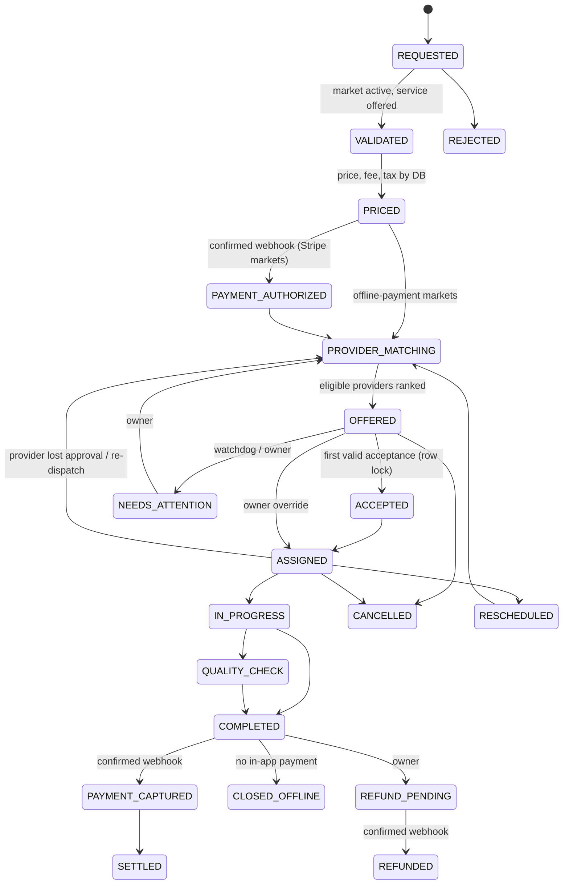

# We Clean It All — Master orchestration

Migration: `marketplace/supabase/orchestration.sql` (additive; old `status` keeps working for the app).
**Status: built and tested (17/17) on 2026-11-02 against the live schema inside a rolled-back transaction. NOT applied to production yet — needs explicit approval of the production change.**

## Booking lifecycle

## Guarantees (each tested)
| Guarantee | How | Test |
|---|---|---|
| Every move is in the graph | trigger on every status change → `_record_transition` | invalid move blocked even for owner ✔ |
| Full history | append-only `domain_events` (actor, from→to, reason) | intake + service sequences ✔, append-only ✔ |
| No fake payment states | payment states only from confirmed provider events; offline markets close as CLOSED_OFFLINE | ✔ |
| No duplicate assignment | `accept_offer` row lock (tested earlier: second acceptance gets "taken") | ✔ (QA suite) |
| No duplicate external operation | `outbox_jobs.idempotency_key` unique | ✔ |
| One worker per job | `outbox_claim` with `FOR UPDATE SKIP LOCKED` + lease | ✔ |
| Safe retries | exponential backoff 30 s, 1, 2, 4, 8 min…; after 6 → `dead` + owner alert | ✔ |
| Restart recovery | expired lease → claimable again; state only in DB | ✔ |
| Duplicate webhooks ignored | `inbox_events` primary key (provider, external_id) | ✔ |
| Stuck workflows get a person | `orchestration_watchdog` (every 10 min) → owner alert + event | ✔ |
| Owner intervention | `admin_flag_attention`, `admin_assign`, `admin_booking_history` (2-step) | history ✔, permissions ✔ |

## Rollback
Drop the new triggers (`a0_booking_workflow_init`, `a_booking_workflow_insert`, `a3_booking_workflow_update`, `z_booking_close_offline`) and unschedule `orchestration-watchdog`; tables can stay (unused). The app keeps working on `status`.
